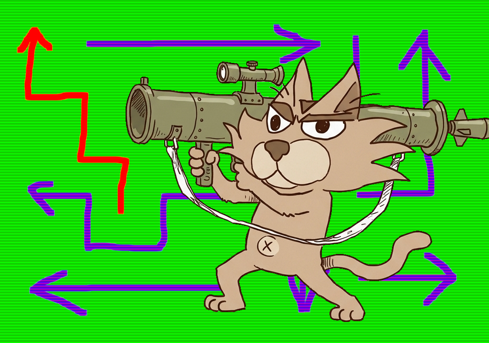
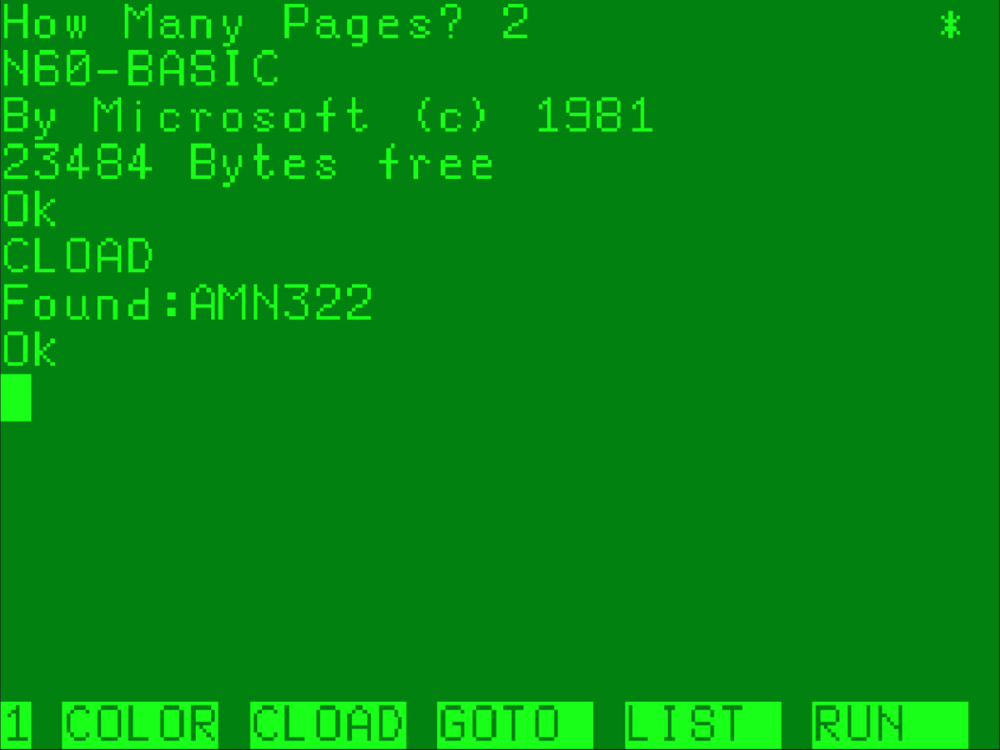
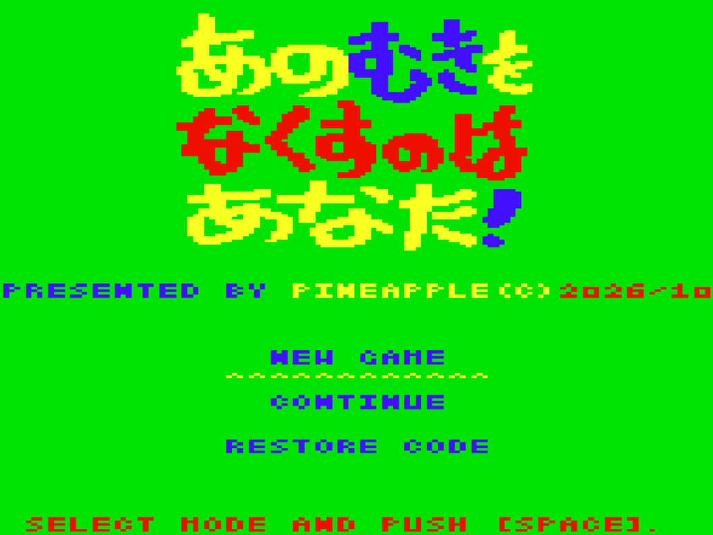
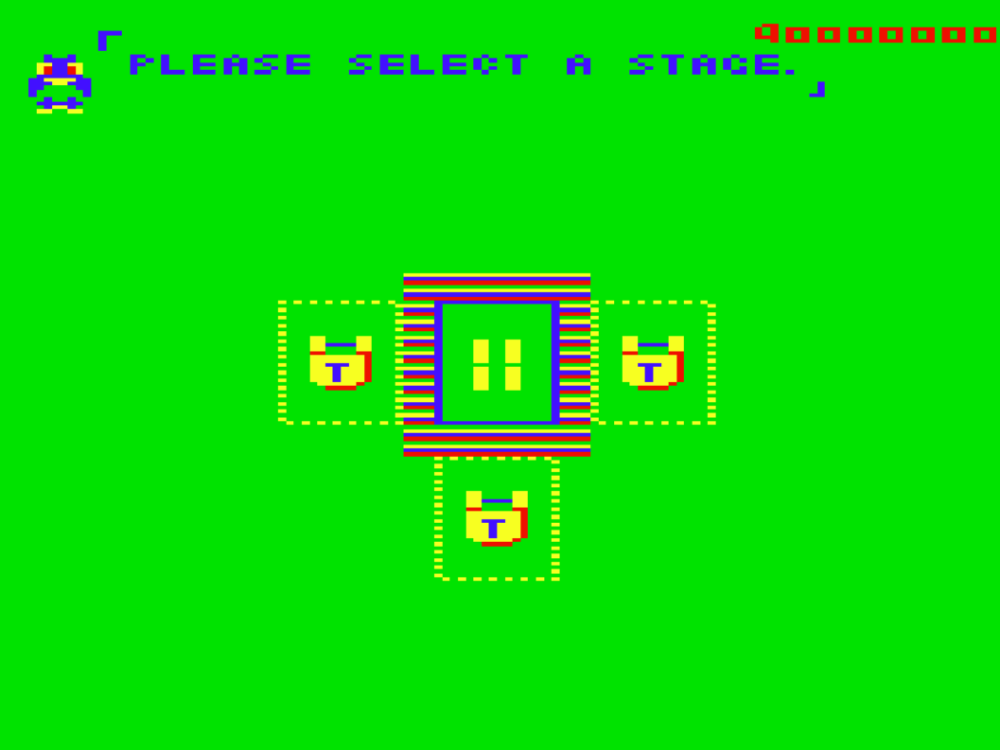
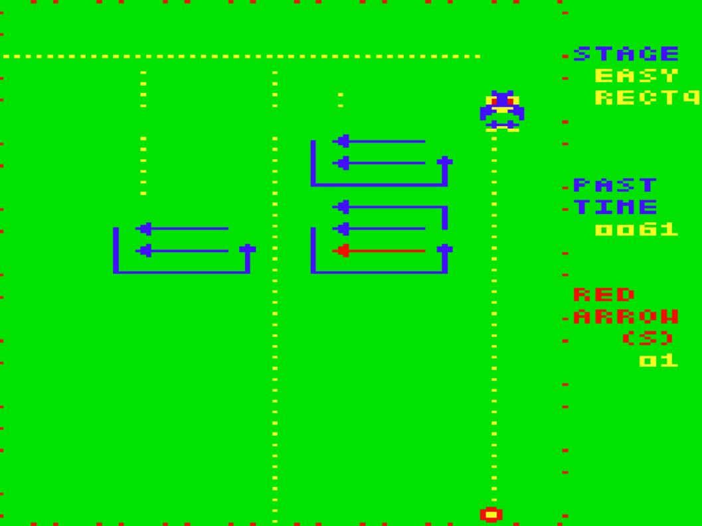
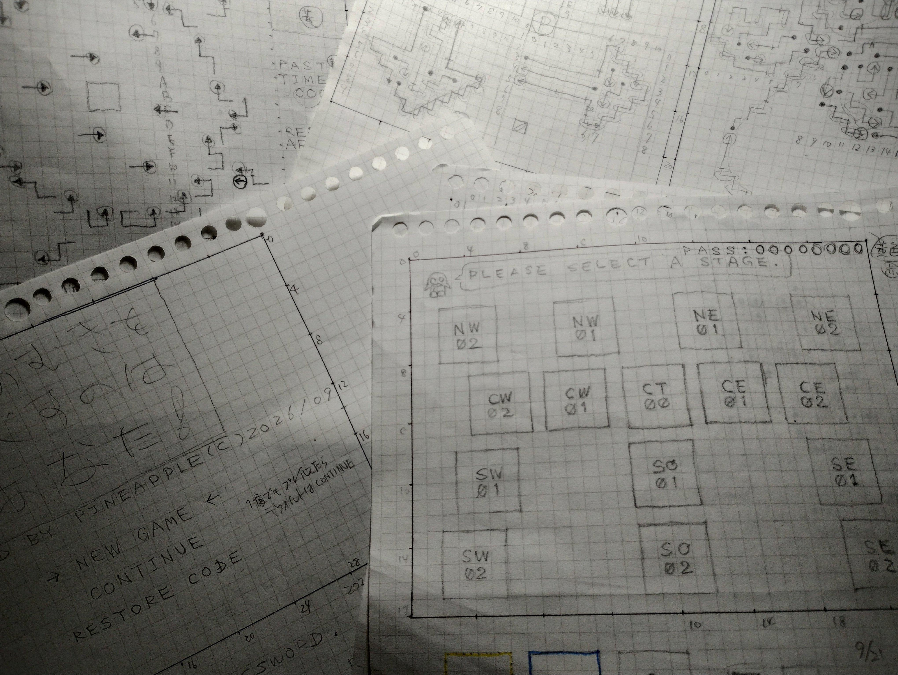
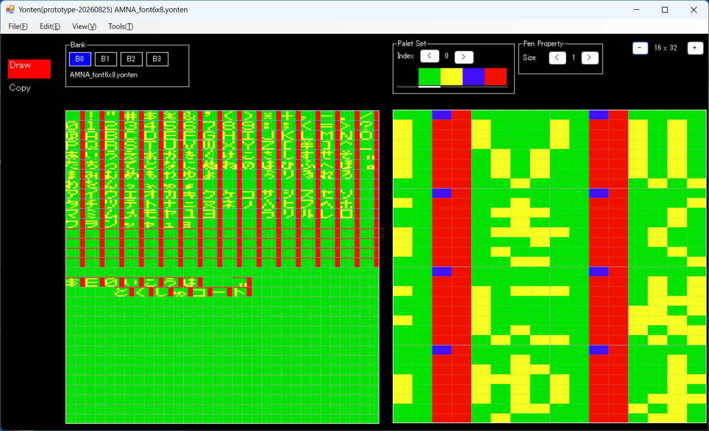

# あのむきをなくすのはあなた

<!-- markdownlint-disable MD033 -->



- [あのむきをなくすのはあなた](#あのむきをなくすのはあなた)
  - [ストーリー](#ストーリー)
  - [動画URL](#動画url)
  - [動作条件](#動作条件)
  - [プログラムの起動方法](#プログラムの起動方法)
  - [操作方法とかルールとか](#操作方法とかルールとか)
    - [タイトル画面](#タイトル画面)
    - [ステージ選択画面](#ステージ選択画面)
    - [さっくりルール](#さっくりルール)
      - [どのように矢印を移動させる？](#どのように矢印を移動させる)
  - [ふりかえり](#ふりかえり)
    - [ひらがな・カタカナ](#ひらがなカタカナ)
    - [仕様は作りながら…](#仕様は作りながら)
    - [BASICの行番号](#basicの行番号)
    - [「俺を破壊しているのは…俺だった！」](#俺を破壊しているのは俺だった)
    - [メモリがギリでした](#メモリがギリでした)

## ストーリー

誰？「スマホとかで動画見たらポイントもらえるやつあるじゃん」

自分「はあ……だ、だれ？」

誰？「あれで矢印タップして画面外に出すやつあるじゃん」

自分「そういやありましたね」

誰？「あれ面白いのかな？」

自分「どうなんすかねぇ？やったことないんで…」

誰？「あれ俺のパソコンでやりたいんだけど出来るかな？」

自分「なんで素直にスマホでやらないんすか？」

誰？「あれ俺のパソコンで出来ねえのかな！？💢」

自分「なんでキレてるんすか？…ていうか誰ですかあんた？」

誰？「俺のPC6001（初代）でやらせろよ！💢」

自分「えぇぇぇ…パピハラ？…カピバラみたいだなぁ…しゃあねえ作るか、やったこと無いけど」

## 動画URL

https://youtu.be/Ni2vJh-lQc8

## 動作条件

- メモリは32KBでお願いします。
- ページ数は2でお願いします。

## プログラムの起動方法

起動までの手順はこんな感じです。

- カセットケーブルの白をwav再生デバイスと接続します
- PC6001（無印）実機にROM&RAMカードリッジを挿して起動します
- 起動すると、How Many Pages? と出るので、<br/> `2`キーを押して、`RETURN`キーを押してください。
- `CLOAD`と打ち込み `RETURN`キーを押して、***CLOAD***コマンドを実行します
- wav再生デバイスで`P6_AMN_32k_p2_16bit.wav`を再生します
  - `AMN322` という名前で読み込まれます<br>
- `RUN`と打ち込み `RETURN`キーを押して、***RUN***コマンドを実行します

## 操作方法とかルールとか

### タイトル画面

起動すると、PINEAPPLEロゴが表示されその後タイトル画面が表示されます。



カーソルキーの`↑`,`↓`キーで  

- NEW GAME : 最初からの状態でプレイ
- CONTINUE : 前回の続きからプレイ
- RESTORE CODE : 前回の続きのコードを入力

…のいずれかを選び、[SPACE]キーで決定します。

### ステージ選択画面

NEW GAME や CONTINUE を選択、RESTORE CODEでコードを入力したりするとステージ選択画面になります。



四角いギラギラした枠を`↑`,`↓`,`←`,`→`キーで移動させて、ステージを選択して[SPACE]キーで決定します。

青の四角（プレイ可能）や赤の四角（クリア）で囲われたステージはプレイすることが出来ます。黄色い点線の四角で囲われたステージは隣り合うステージをクリアすることで、プレイ可能ステージとなります。

ちなみに右上の赤い８桁の１６進数はリストアコードで、これを値をメモしておくと、次回 RESTORE CODEを選んで入力することにより続きの状態からのプレイが可能となります。

### さっくりルール

このゲームは、フィールド上にある赤い矢印を移動させて、全て画面外に退場させるのが目的です。



#### どのように矢印を移動させる？

プレイヤーはペンギンのような謎キャラを[↑] [↓] [←] [→]キーで移動したり [SPACE]キーで弾を発射したり出来ます。

発射した弾が矢印の先端に当たると、矢印は移動を始めます。このようにして、全ての赤い矢印を画面外に退場させるとクリアとなります。

プレイヤーは矢印の先端に刺されるとミスとなります。

そのステージをやり直したい時は[ESC]キーを押してください。そのステージをキャンセルしてステージ選択画面に戻ります。

全15ステージとちょっと少なめですが…

楽しんで頂けるとコレ幸いです🙇‍♂️

## ふりかえり



### ひらがな・カタカナ

開発は６月終わり頃か７月頭ぐらいに始めたような気がします。最初は SCREEN3 で 6x8サイズでひらがな・カタカナをバリバリ表示させたい！…と思っていたので、ちまちまとフォントデータを作っていたのですが…



ゲームメインを作っていく途中で「なんか、ひらがな・カタカナ表示イマイチかなあ」と思い始め、結局ボツになってしまいました。…まあ、考えながら作っていくとそういうことよくありますね😆

### 仕様は作りながら…

最初は時間制限ありでお邪魔ロボットやらブロックなども考えていたのですが、いろいろと考えてやはりパズルは純粋に解くだけのほうが良い気がするという考えに落ち着きました。

### BASICの行番号

BASICの行番号は六角地雷除去の時から、基本的に年（下２桁）＋月（２桁）って規則に則って設定しております。

今回は最初は2607だったんだけど、８月に突入したので 2608（2026年の08月）に変更。しかしステージデータを作成するためのステージデータの構造と実装に時間がかかってしまい…2609に変更。９月はステージデータをちまちまと作っていたらあっという間に10月になってしまい…結局2610になったのでありました。

### 「俺を破壊しているのは…俺だった！」

10月に入って、ステージ選択画面からゲームメインに突入すると暴走するという現象が発生してて「え～マジ～！？」と半泣き状態だったことがありました。ちゃんと気をつけてたつもりなんだがなあ…。

でもよく見てみたら、デバッグ確認のためにステージデータの展開部分の情報をメモリにガシガシ書き込んでいて、そこが書き込みすぎてステージワークを破壊していました😭

そんな素敵な想い出のコードはこちら。

```asm
FscSetArrow:
        ;(debug)----ここから
        PUSH   IX
        LD     IX,D8FFH
        LD     (IX+0),FFH
        ;(debug)----ここまで
;
        LD      A,(BC)
        INC     BC
        LD      L,A
            :
            :
.lp00
        LD      (HL),D      ; フィールドに書き込み！！
;
        ;(debug)----ここから
        ; ※ここの部分がいっぱい呼び出され IXがステージワークに到達
        LD     (IX+0),D
        DEC    IX
        LD     (IX+0),FFH
        ;(debug)----ここまで
;
            :
            :
```

### メモリがギリでした

10月に入ってビビったのは、メモリがギリギリの状態だったってとこですね。以下は最新のリストファイルの最後のほうですが、D900Hからステージワークとして使用しているので、残り68バイト？って感じです。

会社でWindowsのファイルパスのバッファが数千バイト確保されているのを見るたびに「その…そのメモリをP6に分けてくれッ！」と心のなかで叫んでいたり（ヤベー奴だな）

```text
                                ;
                                ; フッダー部分
                                ;
       D8B4                     FOOTER:
0054C3 D8B4 0000000000              DB  00H,00H,00H,00H,00H
0054C8 D8B9 0000000000              DB  00H,00H,00H,00H,00H

```
